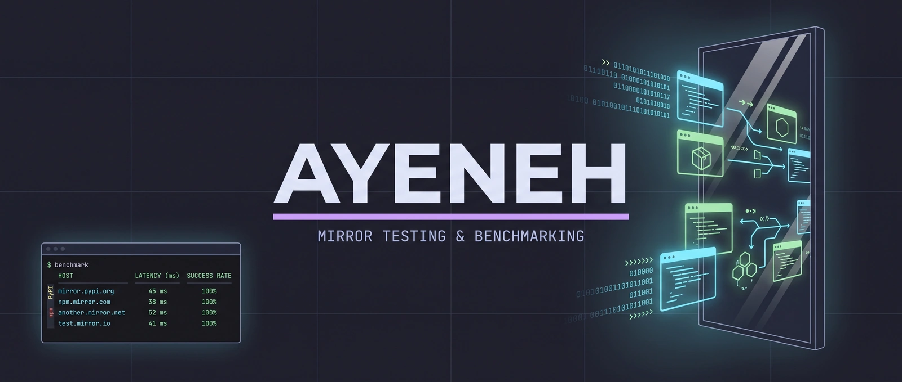
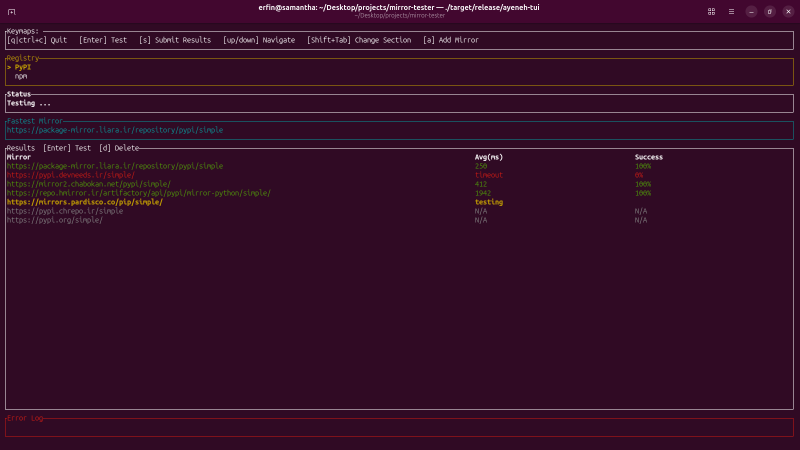

# Ayeneh

A terminal tool for installing packages through mirrors and benchmarking their performance, with a CLI and an interactive TUI.

## Supported Package Managers


|Registry        |Package Manager        |
|----------------|-----------------------|
|PyPI|pip, uv|
|npm |npm|
|Gradle/Maven|gradle, mvn (Maven repositories)|


## Features

- Install packages through configured mirrors, falling back to the next mirror on failure.
- Benchmark mirrors and rank them by average successful attempt time.
- Interactive keyboard-only TUI built with `ratatui`.

## Installation

Download the desired binary from [releases](https://github.com/pasta-engineers/ayeneh/releases). You will also need the three registry JSON files from this repository's `data/` directory; place them in `./data` relative to your working directory, or point `AYN_DATA_DIR` at their directory.

Or build from source:

- Make sure you have Rust (stable) installed via [rustup](https://rustup.rs)

```bash
git clone https://github.com/pasta-engineers/ayeneh.git
cd ayeneh
make
# or
cargo build
```

The binaries are in `target/debug/` (`target/release/` for a release build). Run them by path, or add that directory to your `PATH`. On Windows the binary names end in `.exe`.

Package installation requires the corresponding package manager: Python with pip, npm, uv, Gradle, or Maven. For project commands, Ayeneh tries `./gradlew` or `./mvnw` before `gradle` or `mvn` on `PATH`.

## Quick start

From the repository root after building from source:

```bash
./target/debug/ayeneh-cli run pypi
./target/debug/ayeneh-cli pip install requests
./target/debug/ayeneh-tui
```

From another directory, set `AYN_DATA_DIR` to the absolute path of the repository's `data` directory. The remaining examples assume the binaries are on `PATH` and the data directory is configured.

## Usage

The project ships two binaries:

* `ayeneh-cli` — non-interactive CLI, suitable for CI pipelines, Docker
  images, and shell scripting.
* `ayeneh-tui` — interactive Ratatui application.

Get help:

```bash
ayeneh-cli --help
ayeneh-cli pip --help
ayeneh-cli npm --help
ayeneh-cli gradle --help
```

### Interactive TUI

Launch the TUI:
```bash
ayeneh-tui
```


| Key | Action |
| --- | --- |
| Up / Down | Cycle registries or select a mirror in the results section |
| Shift+Tab | Switch between registries and results |
| Enter | Benchmark the selected registry, or the selected mirror in results |
| `a` | Add a mirror URL; Enter saves and Esc cancels |
| `d` | Delete the selected mirror in results |
| `s` | Save the benchmark-sorted mirror order |
| `q` / Ctrl+C | Quit |

Adding or deleting a mirror immediately updates the selected registry's JSON file. Benchmarking sorts the displayed results; press `s` to persist that order for future installations. The TUI binary also accepts CLI commands as arguments.

### CLI

Install python packages from mirrors:

```bash
ayeneh-cli pip install <package>
```
or install from requirements file:

```bash
ayeneh-cli pip install -r requirements.txt
```

Install npm packages from mirrors:

```bash
ayeneh-cli npm install <package>
```

Add a Python dependency to a uv project:

```bash
ayeneh-cli uv add requests
```

Run Gradle dependency-resolving project commands through the configured Maven
mirrors. The command runs in the current Gradle project directory and retries
with the next mirror if dependency resolution fails:

```bash
ayeneh-cli gradle build
ayeneh-cli gradle sync
ayeneh-cli gradle test --refresh-dependencies
```

`sync` is an Ayeneh command that resolves every resolvable Gradle
configuration. It is useful from a terminal or CI; IDE sync itself is not a
portable Gradle CLI task. Any other Gradle task is forwarded as well.

Run Maven lifecycle phases and plugin goals through the same mirror list:

```bash
ayeneh-cli maven compile
ayeneh-cli maven test
ayeneh-cli maven package
ayeneh-cli maven verify
ayeneh-cli maven install
ayeneh-cli maven sync
```

`sync` maps to Maven's `dependency:resolve`. Maven commands also retry with the
next configured mirror and do not modify `pom.xml` or other project files.

For direct coordinate downloads, the existing Gradle shortcut remains
available. The version may be omitted, in which case Gradle resolves the
newest available one:

```bash
ayeneh-cli gradle install com.google.guava:guava:34.0.0-jre
ayeneh-cli gradle install com.google.guava:guava
```

Gradle artifacts are downloaded into Gradle's own dependency cache, so a later
build that uses the same coordinates can reuse them.

Run a one-off benchmark from the command line:

```bash
ayeneh-cli run pypi
ayeneh-cli run npm
ayeneh-cli run gradle
```

Each attempt resolves and downloads a real sample package, then deletes its temporary file; it does not install the package. Results show the average elapsed time of successful attempts, including resolution and download, and the percentage of attempts that succeeded. A mirror's metadata may point the archive download to another host. Results therefore reflect the full request path rather than throughput alone.

Generate a JSON report for all package managers:

```bash
ayeneh-cli report
```

Run the scheduler in the foreground (one hour between completed cycles by default; stop it with Ctrl+C):

```bash
ayeneh-cli schedule
```

## Example Report

`reports/2026-07-12_14-30.json`:

```json
{
  "registry": "pypi",
  "generated_at": "2026-07-12T14:30:00+00:00",
  "results": [
    { "mirror": "https://pypi.org/simple/", "latency": 120, "success": 100.0 },
    { "mirror": "https://mirror.example1/simple/", "latency": 180, "success": 100.0 }
  ],
  "best": "https://pypi.org/simple/"
}
```

`latency` is in milliseconds, `success` is a percentage, and `best` is `null` if no mirror succeeds. Reports use a local timestamp in their filename with minute precision. Reports saved within the same minute use the same filename and overwrite one another, including reports for different registries.

## Configuration

| Variable | Meaning | Default |
| --- | --- | --- |
| `AYN_DATA_DIR` | Directory holding the registry JSON files | `./data` |
| `AYN_REPORTS_DIR` | Directory for generated reports | Auto-detected `reports/` |
| `AYN_TIMEOUT` | HTTP timeout in seconds | `15` |
| `AYN_ATTEMPTS` | Benchmark attempts per mirror | `3` |
| `AYN_SCHEDULE_INTERVAL_SECS` | Delay between scheduler cycles in seconds | `3600` |

Numeric variables fall back to their defaults when unset, non-numeric, zero, or negative.

## Mirror Lists

`pypi.json`, `npm.json`, and `gradle.json` each define the sample `package` to
download during benchmarking and the list of `mirrors` to test it against. By
default, the program reads them from `./data`:

```json
{
    "package": "requests",
    "mirrors": [
        "https://pypi.org/simple/",
        "https://pypi.devneeds.ir/simple/",
        "https://package-mirror.liara.ir/repository/pypi/"
    ]
}
```

Set `AYN_DATA_DIR` when the registry files are stored elsewhere:

```bash
AYN_DATA_DIR=/opt/mirror/registries ayeneh-cli run pypi
```

Edit these JSON files to add or remove mirrors, or to change the package used
for benchmarking. Mirror lists are configured statically — no network
scraping is performed to discover them.

In `gradle.json` the `package` is a pair of Maven coordinates
(`group:artifact`, e.g. `com.google.guava:guava`) and each mirror is a Maven
repository root, so the same list can be used as a `maven { url ... }`
repository in Gradle or Maven.

### Docker

A Python-based image is provided that ships the prebuilt `ayeneh-cli` binary
alongside the mirror registry config, so it can be used directly as a base for
installing packages or benchmarking. Build it from the repository root (a
release binary must already exist):

```bash
cargo build --release -p ayeneh-cli
docker build -f docker/Dockerfile.python -t ayeneh-cli .
```

Run it, or extend it in your own Dockerfile to install packages from mirrors:

```bash
docker run --rm ayeneh-cli ayeneh-cli pip install requests
```

```dockerfile
FROM ayeneh-cli
COPY requirements.txt .
RUN ayeneh-cli pip install -r requirements.txt
```

A Node.js-based image is provided for npm. Build it the same way (a release
binary must already exist):

```bash
docker build -f docker/Dockerfile.npm -t ayeneh-cli-npm .
```

Run it, or extend it in your own Dockerfile to install packages from npm
mirrors:

```bash
docker run --rm ayeneh-cli-npm ayeneh-cli npm install lodash
```

```dockerfile
FROM ayeneh-cli-npm
RUN ayeneh-cli npm install lodash express
```

To retain reports after a container exits, mount a host directory:

```bash
mkdir -p reports
docker run --rm -v "$(pwd)/reports:/app/reports" ayeneh-cli ayeneh-cli report
```

## Troubleshooting

- **Registry file not found:** Run from a directory containing `data/`, or set `AYN_DATA_DIR` to the directory containing the registry JSON files.
- **No mirrors reachable:** Check network and DNS connectivity, the mirror URLs and sample package in the registry JSON, and the timeout. A mirror may also lack the package or return unusable metadata.
- **Package manager not found:** Install the relevant tool and make it available on `PATH`; for Gradle or Maven project commands, check that the project wrapper is executable or install the corresponding tool.
